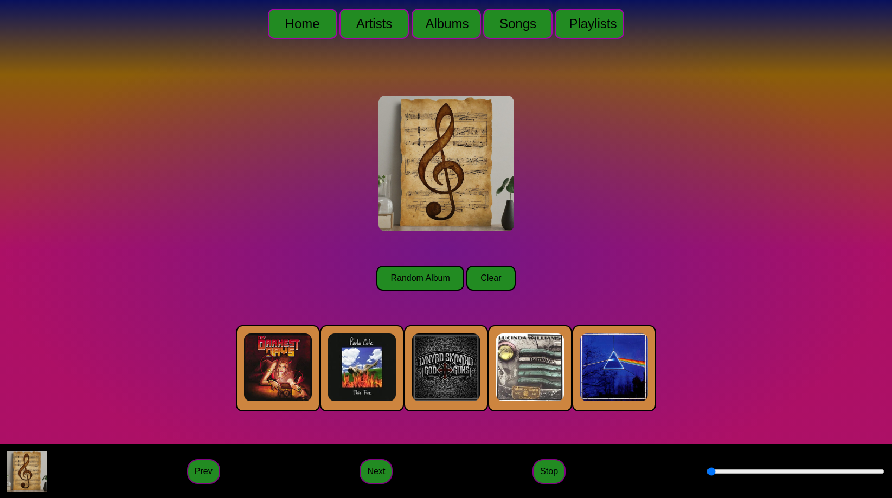

# rusic



rusic is part of the rusic trio (rusicsetup, rusic, rusic-svelte).
Rusic has been designed to run on the raspberry pi 3b+, 4 and 5.
This project will probably run on any debian based system.

Install sequence:

1. Run rusic
2. Run rusic-svelte

## Prerequisites

1. raspberrypiOS (bookworm/trixie)
2. docker installed and running

## Usage

1. Create the directories:
    /usr/share/rusic
    /usr/share/rusic/db
    /usr/share/rusic/thumbs
2. Adjust permissions as needed to do the next step
3. Git clone this repository to /usr/share/rusic/
    ```bash
    cd /usr/share/rusic
    git clone https://github.com/cjsmocjsmo/rusic
    ```
   Your should have the folder layout such as:
    /usr/share/rusic/rusic
4. Execute rusic.py:
    ```bash
    python3 rusic.py -i 0.0.1

```bash
mkdir /usr/share/rusic
mkdir /usr/share/rusic/db
mkdir /usr/share/rusic/thumbs

cd /usr/share/rusic

git clone https://github.com/cjsmocjsmo/rusic.git

cd /usr/share/rusic/rusic

python3 rusic -i 0.0.1

```

The source code for the rust binaries in /rusic/setup can be found at:
    https://github.com/cjsmocjsmo/rusicsetup

## Updating

This is still a work in progress

## FLAC playback on Tizen

Clients that cannot play FLAC can append `?format=mp3` to a `/Music/` URL.
FLAC files are converted to 192 kbps MP3 using ffmpeg, then cached for later
requests; other files and requests without the parameter are served unchanged.
The first request waits for conversion, which can take time on a Raspberry Pi.
At most two different files are converted at once; if both slots are busy,
the server returns HTTP 503 and the client can retry.

The Docker images include ffmpeg. For a non-Docker installation, install
ffmpeg with the `libmp3lame` encoder and make it available on `PATH`.
Set `RUSIC_MP3_CACHE_DIR` to a writable directory to choose the cache location.
By default it is `mp3-cache` beside `RUSIC_DB_PATH`, or `cache/mp3` in the
working directory if `RUSIC_DB_PATH` is unset. The standard Docker launcher
mounts the database directory, so the default cache persists across container
replacements. The cache is not size-limited; monitor available disk space and
remove old cache files when needed. Cache invalidation uses the source path,
size and modification time; if replacing a file while preserving both its size
and timestamp, update its modification time or remove the cached files.
Conversions continue if a client disconnects and time out after 10 minutes.

## Warning

Rusic was designed to run on your home network and not on the wider internet.  It has no authentication system or TLS support, so you have been warned!!!

Rusic is very much a work in progress so there may be some breaking changes in the future.